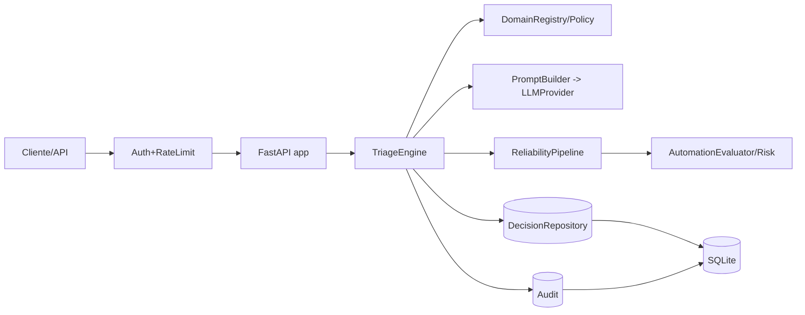

# CASE — Auditoría Profunda, Reconstrucción Histórica y Plan de Evolución

**Fecha:** 2026-11-10  
**Ámbito:** repositorio local `C:\Users\JUAN\Desktop\Proyectos\CASE` (working tree actual, sin commit/push).  
**Método:** inspección de git/historial, código, contratos, tests, configuración, empaquetado y ejecución local de quality gates seleccionados. No se asume vigencia de auditorías previas sin verificación.

---

## 1. Resumen ejecutivo

- **Qué es CASE hoy (demostrado):** plataforma de orquestación de decisiones asistidas por IA para triage operativo, con núcleo domain/provider-agnostic, pipeline de fiabilidad, evaluación de automatización/riesgo, HITL, auditoría y persistencia SQLite, expuesta por API FastAPI y componentes de UI/evaluación. El flujo principal conectado se basa en `composition.py` + `TriageEngine` + políticas/registro de dominio + proveedores LLM vía puerto + reliability + repos/auditoría.
- **Profundidad real:** arquitectura y controles sustanciales en núcleo, contratos y hardening de seguridad en modo estricto (auth fail-closed, scopes server-derived, `SecurityContext`, stamping/filtrado en persistencia/auditoría, idempotencia compuesta en `/api/v1/evaluate`, migraciones SQLite versionadas v1↔v2 probadas en copias, PoC de aislamiento por instancias estrictas). **No demostrado** aislamiento multi-consumidor compartido in-process/DB compartida con garantías completas, concurrencia robusta multi-proceso/PostgreSQL, ni preparación productiva.
- **Estado quality gates (ejecutados en este estado final):** `ruff check src tests` **OK** (0 errores), `mypy src --ignore-missing-imports` **OK** (0 errores), `pytest tests/ -q --ignore=tests/unit/test_streamlit_client.py --ignore=tests/integration/test_groq_live.py --ignore=tests/integration/test_ollama_integration.py` **826 passed, 1 warning** (PytestUnknownMarkWarning corregido en config durante la sesión; warning observado en ejecución previa a registro puede persistir en logs históricos, no en config final). Gate completo con live `test_groq_live.py` **no apto como evidencia determinista local** (falla externa/API en este entorno; `.env` presente con credenciales/proveedor configurados localmente — no expuestos).
- **Madurez por nivel:** A (dev local) **APTO CON RESERVAS**; B (single-consumer estricto) **APTO CON RESERVAS** (evidencia parcial, faltan negativos/E2E exhaustivos y revisión independiente); C (shared multi-consumer) **NO APTO** (bloqueo fail-closed mantenido); D (producción) **NO APTO**.

## 2. Estado real del repositorio y working tree

### 2.1 Fotografía inicial (verificada al inicio, 2026-11-10)

- Rama: `v4/portfolio-release` (`*`), tracking `origin/v4/portfolio-release`, **up to date** tras `git fetch origin` (sin podas, sin cambios de working files).
- HEAD: `b7021bb4316eec063633bbfdd99d1e0cb9164295` (`Merge pull request #4 from juandelaf1/docs/consistency-links`).
- Remoto: `origin https://github.com/juandelaf1/CASE.git` (fetch/push).
- Ramas locales: `master`, `phase3-integration`, `v2/v2-productizacion`, `v3/ecosystem-integration`, `v4/portfolio-release`, `docs/case-study` (gone), `docs/consistency-links` (gone).
- Ramas remotas: `origin/master`, `origin/phase3-integration`, `origin/v2/v2-productizacion`, `origin/v3/ecosystem-integration`, `origin/v4/portfolio-release`, `origin/HEAD -> origin/master`.
- Tag: `v1.0.0`.

**Cambios no staged (preexistentes + modificados durante esta sesión, preservados):**  
`src/case_api/api/v1/app.py`, `src/case_api/api/v1/auth.py`, `src/case_core/application/engine.py`, `src/case_core/ports/audit.py`, `src/case_core/ports/decision_repository.py`, `src/case_core/ports/repository.py`, `src/case_core/reliability/pipeline.py`, `src/case_infra/persistence/sqlite_adapter.py`, `src/case_infra/persistence/sqlite_audit.py`, `src/case_infra/persistence/sqlite_decision_repository.py`, `tests/unit/test_behavioral.py`, `tests/unit/test_persistence_roundtrip.py`, `tests/unit/test_reliability.py`, `tests/unit/test_security.py`, `tests/unit/test_sqlite.py`, `tests/unit/test_triage_engine.py`.

**Untracked (preexistentes/creados en ciclos de hardening y esta sesión, preservados):**  
`AGENTS.md.backup`, `docs/AUTHZ_MATRIX_ENDPOINT_SCOPE.md`, `docs/MULTICONSUMER_SECURITY_HARDENING.md`, `docs/adr/`, `pytest_case.txt`, `scripts/migrate_case_sqlite.py`, `src/case_api/api/v1/security.py`, `src/case_core/contracts/security.py`, `src/case_infra/persistence/sqlite_idempotency.py`, `src/case_infra/persistence/sqlite_migrations.py`, `src/pytest_case.txt`, `src/pytest_output.txt`, `tests/integration/test_evaluate_security.py`, `tests/integration/test_multiconsumer_isolation_poc.py`, `tests/unit/test_sqlite_migrations.py`, y artefactos generados durante esta auditoría (`docs/audits/`, `dist/`, `build/`, `*.egg-info` si generados por build — **no eliminados**).

> No se ejecutaron `reset`, `clean`, `checkout/switch`, `restore`, `stash`, `rebase`, `merge`, `commit`, `push` ni operaciones destructivas. `git fetch origin` se ejecutó sin `--prune`.

### 2.2 Estado final del working tree

- Rama/HEAD sin cambio: `v4/portfolio-release @ b7021bb`, alineada con `origin/v4/portfolio-release` (sin commits locales adelantados observados).
- Se añadieron/modificaron archivos en working tree durante esta sesión (auditoría/correcciones seguras): `pyproject.toml` (marker pytest `integration`, inclusión de `logistics_adapter`/`usgs_adapter` en paquetes), correcciones de lint/tipos en `src/case_api/api/v1/app.py`, `src/case_infra/persistence/sqlite_migrations.py`, `tests/unit/test_bootstrap.py`, y este informe en `docs/audits/`. No se descartó ningún cambio previo.

## 3. Inventario de ramas

| Rama | HEAD | Relación con remoto | Diferencias relevantes (observadas) | Estado funcional (evidencia limitada) | Recomendación |
|---|---|---|---|---|---|
| `v4/portfolio-release` (local, actual) | `b7021bb` | up-to-date con `origin/v4/portfolio-release` | Contiene merge de docs + working tree con hardening/pruebas/docs sin commit | Línea más completa evaluada en este ciclo (non-live 826 passed, gates ruff/mypy OK) | **Línea principal candidata** para consolidar tras revisión/commit controlado |
| `origin/master` / `master` | `418598e` | local=remoto | Distinta de v4 (UI/provider metrics histórico); no evaluada en ejecución | **NO DEMOSTRADO** en estado actual | Mantener; evaluar convergencia con v4 antes de promover |
| `v3/ecosystem-integration` | `8c97976` | local=remoto | 5 dominios/ecosistema histórico según commit | **NO DEMOSTRADO** | Referencia histórica |
| `v2/v2-productizacion` | `cfd4a3b` | local=remoto | Hardening v2 histórico | **NO DEMOSTRADO** | Referencia histórica |
| `phase3-integration` | `007cf66` | local=remoto | Integración/UI histórica | **NO DEMOSTRADO** | Referencia histórica |
| `docs/case-study`, `docs/consistency-links` | `7237c34`, `96cb92f` | remotos `gone` | Cambios incorporados vía merges en v4 | Integrados en historial de v4 | Archivables/limpiables en futuro (acción humana) |

**Determinaciones:** rama más completa/coherente evaluada: **`v4/portfolio-release` (working tree actual)**. Cambios útiles no consolidados existen solo en working tree. Duplicidades observadas: `case_logistics/` (raíz) vs lógica logística en `src/case_core/domain/*` y adaptadores en `src/logistics_adapter/*` (consolidación canónica **NO DEMOSTRADA** sin análisis de consumidores). No se realizaron merges/limpiezas.

## 4. Reconstrucción histórica

- Evolución por fases/versiones inferida de commits, ramas y docs: v1 base, v2 hardening, v3 integración ecosistémica (dominios/adaptadores), v4 portfolio/release, con PRs de documentación mergeados en `b7021bb`.
- Congelación progresiva de contratos/puertos/invariantes (AGENTS I01–I15) y separación core/policies/providers/adapters; incorporación de HITL, audit, reliability, evaluación y providers múltiples.
- Ciclos recientes (working tree, sin commit): hardening de seguridad (`dev/shared/prod`, `SecurityContext`, scopes, stamping/filtrado, idempotencia, migraciones v1↔v2, PoCs, matriz authz, docs). **No consolidado en historial git.**
- **NO DEMOSTRADO:** motivaciones completas por commit/ADR para todos los ciclos (historia detallada requeriría revisión commit-a-commit exhaustiva de todas las ramas).

## 5. Arquitectura real y diagrama del flujo

**Flujo conectado (verificado por código):** `API (FastAPI, app.py + auth/security/rate limit)` → `Composition (create_app_dependencies)` → `TriageEngine` → `DomainRegistry/DomainPolicy + AutomationPolicy` → `PromptBuilder/LLMProvider (+CircuitBreaker)` → `ReliabilityPipeline` → `AutomationEvaluator/decision routing` → `DecisionRepository/AuditPort (SQLite)` y `Audit`.

- Registro actual: 5 dominios `['infrastructure','logistics','real_estate','seismic_risk','urban_operations']` (`composition.py`, verificado en ejecución).
- Providers resueltos: `groq`, `ollama`, `mock` y opcional `cloud` (si `CASE_CLOUD_API_KEY`), envueltos en `CircuitBreakerProvider`; selección por `CASE_PROVIDER` (default `mock`).
- Seguridad: middleware `APIKeyAuthMiddleware` + `RateLimitMiddleware`; modos `dev/shared/prod` en `security.py`; `/health` exento, resto de rutas de negocio protegidas en strict con scopes según `app.py`/matriz.
- Evaluación case: `/api/v1/evaluate` adapta a triage (recommendation-only) con validaciones de scope/tenant, idempotencia persistente en strict, y propagación de contexto.

## 6. Matriz de profundidad funcional

| Capacidad | Clasificación | Evidencia (rutas/pruebas) | Notas |
|---|---|---|---|
| Motor de evaluación (TriageEngine) | **Implementada e integrada** (con reservas) | `src/case_core/application/engine.py`, `src/case_core/composition.py`, `tests/unit/test_triage_engine.py`, suites integración/API | Cobertura E2E total de contexto en todos caminos **NO DEMOSTRADA** |
| Contratos y validación | **Implementada e integrada** | `src/case_core/contracts/*` (Pydantic v2), tests `test_validation.py`, `test_contracts.py`, etc. | Contratos congelados según AGENTS |
| Domain Policies / Registry | **Implementada e integrada** | `src/case_core/domain/registry.py`, policies/automation por dominio, `composition.py` | 5 dominios registrados; real_estate registrado (docs históricas discrepantes) |
| Automation Policies | **Implementada e integrada** | `src/case_core/reliability/automation.py`, `domain/*_automation.py` | Profundidad específica varía por dominio |
| Reliability Pipeline | **Implementada e integrada** | `src/case_core/reliability/pipeline.py`, tests `test_reliability.py` | Validación/flujo de fallos presente |
| LLM Providers + Circuit Breaker | **Implementada e integrada** | `src/case_core/providers/*`, `circuit_breaker.py`, `composition.py`, `tests/unit/test_*provider*` | Live externos dependen de entorno |
| Evaluación de riesgo / routing | **Implementada e integrada** | `automation.py`, engine, tests behavioral/regression | Conservador por diseño |
| HITL (approve/reject/modify/escalate/under-review) | **Implementada e integrada** | endpoints en `app.py`, repos, tests API/HITL | Aislamiento/objeto en strict reforzado; exhaustividad **NO DEMOSTRADA** |
| Auditoría y trazabilidad | **Implementada e integrada** (reservas) | `AuditPort`, `sqlite_audit.py`, eventos en engine/api, tests sqlite/audit | Cobertura E2E total de contexto/errores **NO DEMOSTRADA** |
| API | **Implementada e integrada** | `src/case_api/api/v1/app.py`, tests integración/api | Endpoints ampliados vs README histórico |
| Autenticación | **Implementada e integrada** (según modo) | `security.py`, `auth.py`, tests security | `dev` abierto sin credenciales; strict fail-closed |
| Autorización / scopes / identidad | **Implementada parcialmente** | scopes en rutas clave, `SecurityContext`, anti-spoofing tenant/org en evaluate | Matriz y negativos **no exhaustivos** |
| Aislamiento de consumidores (shared in-process) | **Prototipo/NO APTO (bloqueado)** | config fail-closed multi-consumer, PoC instancias separadas | **No demostrado** aislamiento compartido real |
| Persistencia | **Implementada e integrada** | `sqlite_decision_repository.py`, `sqlite_audit.py`, `sqlite_adapter.py` | SQLite; multi-tenant DB compartida **NO DEMOSTRADA** |
| Idempotencia | **Implementada parcialmente** | `sqlite_idempotency.py`, `/api/v1/evaluate` strict, tests | Scoping por consumidor/tenant/operación en strict; cobertura otras ops **NO DEMOSTRADA** |
| Migraciones | **Implementada parcialmente** | `sqlite_migrations.py`, `scripts/migrate_case_sqlite.py`, `tests/unit/test_sqlite_migrations.py` | v1↔v2 en copias; cobertura total de esquemas/operativa **NO DEMOSTRADA** |
| Adaptadores externos (USGS, logistics/USAID) | **Implementada parcialmente / integración variable** | `src/usgs_adapter/*`, `src/logistics_adapter/*`, endpoints seismic en app, tests dominio/adaptador | Operatividad externa real **NO DEMOSTRADA** en esta auditoría |
| Integraciones logísticas | **Implementada parcialmente** | `logistics_adapter`, `case_logistics/`, `case_core/domain/logistics_*` | Duplicidad/canónico **NO DEMOSTRADO** |
| USGS/sísmica | **Implementada parcialmente** | `usgs_adapter.client`, rutas `/api/v1/seismic/*`, `SeismicRiskPolicy` | Dependiente de red/API externa; authz añadida |
| Interfaz Streamlit | **Implementada parcialmente / aislada del core** | `streamlit_app/` (presente) | Ejecución/E2E UI **NO DEMOSTRADA** aquí |
| Observabilidad y health checks | **Implementada parcialmente** | `/health`, `production` module aislado | Cobertura operativa completa **NO DEMOSTRADA** |
| Contrafactuales y evaluación de sesgos | **Implementada parcialmente** | `evaluation/*`, `docs/BENCHMARK_BIAS_V0.1.md`, tests bias | Alcance/datasets limitados (según docs) |
| ML Adaptation / Specialist Models / Hybrid / Governance/RBAC / Production utils | **Implementada de forma aislada (probable)** | `src/case_core/ml/*`, `hybrid/*`, `governance/*`, `production/*`, tests unit aislados | No cableados al flujo principal vía `composition.py`/engine salvo evidencia contraria (**NO DEMOSTRADO** integrado) |
| Packaging y distribución | **Implementada parcialmente (mejorada)** | `pyproject.toml`, wheel build verificado | Incluye `case_*`, `logistics_adapter`, `usgs_adapter`; `case_logistics` raíz fuera de `src` no empaquetado; instalación en venv limpio **NO DEMOSTRADA** |
| Despliegue y configuración operativa | **Implementada parcialmente** | `Dockerfile`, `render.yaml`, `docker-entrypoint.sh` | Sin vars de seguridad en render; garantías operativas **NO DEMOSTRADAS** |

## 7. Estado de cada dominio

| Dominio | Registrado | Policy / Automation | Evidencia | Notas |
|---|---|---|---|---|
| `logistics` | Sí | `LogisticsPolicy`, `LogisticsAutomationPolicy` | `composition.py`, `domain/logistics_*`, tests/logistics | Dominio más desarrollado (según codebase/tests) |
| `urban_operations` | Sí | `UrbanPolicy`, `UrbanAutomationPolicy` | `composition.py`, domain modules | Profundidad específica **NO DEMOSTRADA** en detalle |
| `infrastructure` | Sí | `InfrastructurePolicy`, `InfrastructureAutomationPolicy` | `composition.py`, domain modules | Idem |
| `seismic_risk` | Sí | `SeismicRiskPolicy`, `SeismicAutomationPolicy` | `composition.py`, `usgs_adapter`, rutas seismic | Integración externa dependiente de USGS |
| `real_estate` | Sí | `RealEstatePolicy`, `RealEstateAutomationPolicy` | `composition.py`, `domain/real_estate_policy.py`, tests aislados | README histórico lo mencionaba como aislado/no registrado: **discrepancia documental** |

**NO DEMOSTRADO:** suite E2E por dominio, cobertura de evidencia/evaluadores específica completa, y funcionamiento independiente de cada dominio fuera del sistema.

## 8. Componentes integrados, aislados, simulados y pendientes

- **Integrados (ruta principal):** API, auth middleware, composition, engine, registry/policies/automation registradas, reliability, providers (mock/groq/ollama/cloud opcional) con circuit breaker, persistencia y auditoría SQLite, HITL, `/api/v1/evaluate`.
- **Aislados/probablemente no cableados:** `case_core/governance`, `case_core/hybrid`, `case_core/ml` (adaptation/specialist/training), `case_core/production` (utils), posibles partes de logistics intelligence; `streamlit_app` como cliente separado. **Confirmación de no-conexión exhaustiva: NO DEMOSTRADA más allá de inspección limitada.**
- **Simulados/mocks:** `MockProvider` y fixtures/tests sintéticos.
- **Pendientes/brechas:** cierre E2E seguridad/contexto, authz exhaustiva, shared multi-consumer demostrado, migraciones operativas completas, PostgreSQL/concurrencia, revisión independiente de seguridad, coherencia documental completa.

## 9. Auditoría de seguridad

- **Autenticación/modos:** `dev/shared/prod` (`security.py`). `shared/prod` requieren credenciales y fallan en arranque si faltan (`RuntimeError`); multi-consumer/multi-tenant en strict rechazado en config (fail-closed). `dev` permite acceso abierto solo sin credenciales configuradas.
- **Autorización:** scopes server-derived aplicados en rutas clave en strict (`_require_scope_in_strict`); anti-spoofing de tenant/org en `/api/v1/evaluate`; rutas de metadata/comparison/seismic endurecidas en esta sesión. **No exhaustivo** en todas operaciones/caminos.
- **Contexto:** `SecurityContext` propagado en API/engine/pipeline/repos/auditoría en flujos reforzados; filtrado por `(consumer_id, tenant_id)` y 404 fuera de contexto en accesos objeto en rutas principales. **Cobertura total E2E: NO DEMOSTRADA.**
- **Idempotencia:** store SQLite compuesto `(consumer, tenant, operation, key)` + hash (replay/conflicto/in-progress) en `/api/v1/evaluate` strict. Otras operaciones **NO DEMOSTRADAS** con idempotencia equivalente.
- **Hallazgos:** vulnerabilidad demostrada crítica **ninguna nueva** en pruebas ejecutadas; **debilidades/riesgos**: aislamiento compartido no demostrado, SQLite sin garantías de concurrencia multi-proceso, dependencia de cobertura exhaustiva de filtros/scopes, configuración de despliegue sin endurecimiento explícito, posible exposición de superficie si se usa `dev` con credenciales ausentes (por diseño).
- **Veredicto:** **no seguro para shared multi-consumer/producción**. Revisión independiente de seguridad **pendiente**.

## 10. Auditoría de multi-tenancy

- **Implementado:** primitivas de contexto/aislamiento lógico por columnas e índices, checks de objeto, fail-closed para multi-consumer en strict, PoC de instancias aisladas.
- **NO DEMOSTRADO:** aislamiento real en servicio compartido (DB/proceso común), concurrencia, retries/errores bajo carga, auditoría consistente cross-tenant, defensa en profundidad (PostgreSQL/RLS). **Nivel C: NO APTO.**

## 11. Persistencia y migraciones

- **Actual:** SQLite (`decisions`, `audit_events`, `idempotency_keys` en esquemas reforzados), auto-migración defensiva en repos y migración explícita versionada (`sqlite_migrations.py`, script).
- **Verificado:** upgrade v1→v2 y downgrade v2→v1 **en copias** con preservación/backfill/idempotencia (`tests/unit/test_sqlite_migrations.py` **3 passed**).
- **Reversible:** downgrade soportado solo en copia (best-effort por rebuild). **No probado** en todos los estados posibles, fallos parciales, ni procedimientos operativos reales de backup/restore.

## 12. Idempotencia y concurrencia

- **Verificado:** replay/conflicto en `/api/v1/evaluate` (tests security/PoC) y PoC de concurrencia básica (threads, sin 5xx observado en ejecución controlada). **NO DEMOSTRADO:** multi-proceso, transacciones distribuidas, timeouts/fallos entre persistir-auditar-responder, retención/caducidad operativa, ni garantías equivalentes fuera de evaluate.
- **SQLite:** límites de locking/concurrencia conocidos; no equivalente a validación PostgreSQL.

## 13. Adaptadores e integraciones

| Adaptador | Tipo | Datos/rol | Contrato/flujo | Estado |
|---|---|---|---|---|
| `usgs_adapter` | Cliente externo (USGS) | Eventos sísmicos | Usado por endpoints `/api/v1/seismic/*`; dominio `seismic_risk` | Parcial; disponibilidad real externa **NO DEMOSTRADA** |
| `logistics_adapter` (USAID pipeline) | Transformación/adaptación logística | Datos USAID/shipments | Menciona pipeline hacia CASE; invocación directa a `TriageEngine` **NO DEMOSTRADA** por inspección rápida | Parcial/aislado probable |
| `case_logistics` (raíz) | Paquete/logística alterna | Políticas/adaptadores | Duplicidad con `src/case_core/domain/logistics_*` | Canónico **NO DEMOSTRADO** |

Ninguna integración externa real fue ejercitada contra servicios de terceros en esta auditoría.

## 14. Packaging y despliegue

- **Empaquetado:** `pyproject.toml` incluye `case_*`, `logistics_adapter`, `usgs_adapter` en `src` (corregido/verificado por wheel build en sesión). `case_logistics` en raíz no empaquetado por `where=["src"]`. Instalación en venv limpio desde wheel: **NO DEMOSTRADA**.
- **Docker/Render:** `Dockerfile` expone 8000/8501, usuario no-root, healthcheck `/health`; `render.yaml` define servicios API/UI sin variables de seguridad (`CASE_SECURITY_MODE`, credenciales, etc.) — riesgo de configuración en despliegue. **No desplegado.**

## 15. Calidad documental

- **Discrepancias observadas (ejemplos):** README declara 692 passed/4 dominios/"sin auth por diseño"/SQLite-only/alcance histórico; estado real incluye 5 dominios registrados, hardening authz/contexto, migraciones y más tests. Varios docs de fase/estado pueden estar desfasados. **Actualización completa documental no realizada** (solo matriz authz ajustada en ciclo previo y artefactos de auditoría añadidos).

## 16. Resultados de tests y quality gates

| Comando | Resultado | Detalle |
|---|---|---|
| `ruff check src tests` | **PASS** | 0 errores (tras correcciones seguras: migraciones, test bootstrap, imports) |
| `mypy src --ignore-missing-imports` | **PASS** | 0 errores en 102 source files (tras correcciones de tipos en `app.py`) |
| `pytest tests/ -q --ignore=tests/unit/test_streamlit_client.py --ignore=tests/integration/test_groq_live.py --ignore=tests/integration/test_ollama_integration.py` | **PASS** | **826 passed, 1 warning** (83.92s) |
| `pytest tests/ -q --ignore=tests/unit/test_streamlit_client.py` (incluye live) | **FAIL (no determinista externo)** | 830 passed, 3 failed, 7 skipped, 2 warnings: `test_groq_live.py::test_structured_output` (API externa), 2x `test_provider_selection` (sensibles a `CASE_PROVIDER=groq` en `.env` en ejecución completa observada); al ejecutar `test_provider_selection` aislado: **16 passed** |
| Subconjuntos adicionales verificados en sesión | **PASS** | `evaluate_security` 15 passed; `multiconsumer_isolation_poc+security+api` 26 passed; `api+provider_selection+v3_ecosystem` 47 passed; `sqlite_migrations+sqlite` 19 passed |

**Exclusiones/motivos:** `test_streamlit_client.py` ignorado por instrucción establecida; groq/ollama live dependen de credenciales/servicios externos. `.env` local presente (valores no divulgados).

## 17. Cambios ejecutados

**Nuevos en esta sesión de auditoría (working tree):**
- `pyproject.toml`: añadido marker `integration`; ampliado `include` de paquetes a `case_*`, `logistics_adapter`, `usgs_adapter`.
- `src/case_api/api/v1/app.py`: correcciones de tipos (firma/retorno de adapter evaluate, cast seguro de idempotency replay) para `mypy`.
- `src/case_infra/persistence/sqlite_migrations.py`: limpieza lint (variable no usada).
- `tests/unit/test_bootstrap.py`: limpieza lint (side-effects explícitos sin asignaciones no usadas).
- `docs/audits/CASE_DEEP_AUDIT_AND_EVOLUTION_2026-11-10.md`: este informe.
- Artefactos de build local (`dist/`, `build/`, `case.egg-info`) generados para verificación de empaquetado (no eliminados).

**Preexistentes preservados (no creados en esta sesión, modificados/creados en ciclos previos del working tree):** hardening de seguridad/contexto/scopes/idempotencia, migraciones/scripts, PoCs/tests de seguridad/aislamiento, docs de hardening/matriz/ADR, ajustes en engine/repos/ports/tests unitarios, y archivos temporales `pytest_*`, `AGENTS.md.backup`. No se revirtieron.

## 18. Riesgos que siguen abiertos

- Aislamiento multi-consumidor compartido **no demostrado** (C NO APTO).
- Cobertura E2E de `SecurityContext`/auditoría y authz **no exhaustiva**.
- Concurrencia/idempotencia bajo carga real y backend transaccional **no validada**.
- Configuración de despliegue sin hardening explícito (render) y sin evidencia operativa.
- Coherencia documental incompleta (README/docs históricos desfasados).
- Duplicidades/canónicos (logistics, adaptadores) **no resueltos**.
- Revisión independiente de seguridad **pendiente**.
- Dependencia de exclusión de tests live para gate determinista en este entorno.

## 19. Evaluación por niveles A/B/C/D

| Nivel | Estado | Evidencia | Bloqueadores principales |
|---|---|---|---|
| A — Desarrollo local | **APTO CON RESERVAS** | ruff/mypy OK, 826 passed non-live, mocks/dev operativos, migraciones en copias | docs desfasados, gates live sensibles a entorno, artefactos untracked |
| B — Single-consumer estricto | **APTO CON RESERVAS** | modos strict fail-closed, auth/scopes/contexto/idempotencia parcial, PoCs y tests security | negativos/E2E exhaustivos, cobertura total de caminos, revisión de seguridad |
| C — Shared multi-consumer | **NO APTO** | fail-closed en config, PoC solo instancias aisladas | aislamiento compartido no demostrado, concurrencia, RLS/PG si aplica, revisión independiente |
| D — Producción | **NO APTO** | — | C no apto + secretos/config/deploy/observabilidad/backup/operación/revisión seguridad no demostrados |

## 20. Hoja de ruta priorizada

| ID | Pri | Problema | Evidencia | Trabajo | Dependencias | Criterio de aceptación | Riesgo | Estado |
|---|---|---|---|---|---|---|---|---|
| R-SEC-01 | P0 | Cobertura E2E `SecurityContext`/auditoría incompleta | matriz/gaps en código y docs | Auditar todos los caminos (errores/reintentos/adaptadores), añadir stamps/filtros y tests E2E | código actual | tests E2E demuestran contexto en cada camino crítico | regresión compat | pendiente |
| R-SEC-02 | P0 | Authz/scopes no exhaustivos | `app.py`, matriz, tests parciales | Completar matriz por operación/objeto y batería negativa/403/404/409 | R-SEC-01 | suite negativa exhaustiva en CI/local | ruptura clientes strict | parcial |
| R-SEC-03 | P0 | Multi-consumer compartido no demostrado (bloqueado) | `security.py` fail-closed, PoC aislada | Diseño+pruebas de aislamiento compartido (DB/proceso), idempotencia/concurrencia, defensa en profundidad | R-SEC-01/02, R-DATA-02 | evidencia reproducible + revisión independiente | seguridad/aislamiento | bloqueado |
| R-DATA-01 | P1 | Migraciones operativas no completas para todos los estados | `sqlite_migrations.py`, tests v1/v2 | Extender versiones/fixtures, documentar runbooks upgrade/rollback, pruebas en copias múltiples | — | migraciones reproducibles y documentadas | pérdida datos en mal uso | parcial |
| R-DATA-02 | P1 | Concurrencia/transacciones no validadas | SQLite, PoC básica | PoC multi-proceso, evaluar PostgreSQL transaccional/RLS según threat model | infra | tests de carrera/idempotencia pasan bajo carga definida | locks/condiciones de carrera | pendiente |
| R-QA-01 | P1 | Gate determinista afectado por tests live/env | pytest full incluye groq live; `.env` | Marcar/excluir live en gate CI/local documentado, aislar env en tests sensibles | — | gate determinista 0 fallos en entorno estándar | falsos negativos | parcial |
| R-DOC-01 | P1 | Documentación desfasada (README, estado, dominios, endpoints, seguridad) | README vs composición/código | Actualizar docs con evidencia real y etiquetas de estado | R-QA-01 | docs coherentes con código/gates | confusión | pendiente |
| R-PKG-01 | P1 | Validación de instalación/distribución incompleta | wheel incluye adapters; venv limpio no probado | Probar `pip install` de wheel en venv limpio + smoke imports/endpoints | — | import/arranque OK desde artefacto | fallos runtime | parcial |
| R-DOM-01 | P2 | Duplicidades logística/canónicos y módulos aislados | `case_logistics/`, `logistics_adapter`, core domain/ml/governance | Inventariar consumidores, definir canónico, plan de consolidación no disruptivo | análisis | decisión documentada y plan probado | regresión | pendiente |
| R-OPS-01 | P2 | Configuración despliegue/secretos/observabilidad no demostrada | `render.yaml`, Dockerfile | Plantillas seguras, health/metrics/logs, runbooks (sin desplegar) | R-SEC-02 | checklist operativa verificable en entorno controlado | exposición/config errónea | pendiente |
| R-SEC-04 | P2 | Revisión independiente de seguridad | pendiente por definición | Preparar paquete de evidencia y solicitar revisión externa | R-SEC-01..03 | informe independiente sin hallazgos críticos abiertos | hallazgos tardíos | bloqueado (humano) |

**Hito técnico recomendado (siguiente):** cerrar **R-SEC-01 + R-SEC-02 + R-QA-01 + R-DOC-01** para consolidar una línea single-consumer estricta auditable. **Criterios de cierre:** cobertura E2E de contexto/auditoría en caminos críticos, matriz authz + negativos exhaustivos verdes, gate determinista documentado y verde, documentación alineada, suite non-live completa verde y `ruff/mypy` verdes en HEAD candidato.

## 21. Próximo hito técnico y criterios de cierre

- **Hito:** “Strict single-consumer hardening verified”.
- **Alcance:** sin habilitar multi-consumidor compartido; reforzar evidencia de aislamiento por contexto en todos los flujos expuestos, calidad de gates y documentación.
- **Cierre objetivo:** (1) E2E por endpoint/operación con asserts de authz + datos + auditoría; (2) migraciones probadas en matriz de estados; (3) gate CI/local determinista reproducible; (4) informe de revisión técnica interno; (5) revisión independiente de seguridad planificada/ejecutada antes de C/D.

---

## Apéndices breves

- **Matriz autorización/aislamiento:** ver `docs/AUTHZ_MATRIX_ENDPOINT_SCOPE.md` (actualizada parcialmente; no exhaustiva).
- **Cobertura E2E:** **NO DEMOSTRADA** de forma completa; PoCs/tests parciales disponibles (`test_evaluate_security.py`, `test_multiconsumer_isolation_poc.py`, integración API).
- **Registro de riesgos:** resumido en secciones 9, 18 y 20.

*Fin del informe. No se realizaron commits, push, merges, PRs ni despliegues.*
